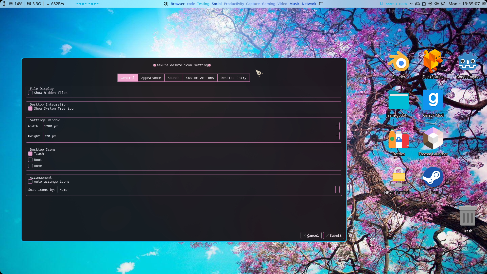
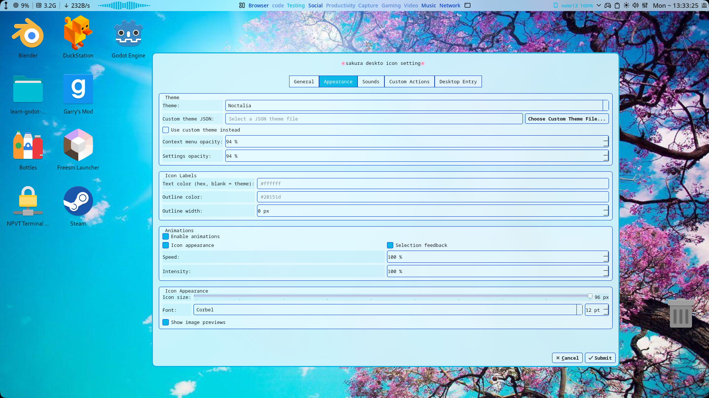

# SakuraDesktopIcons

A customizable desktop icons manager for **Hyprland**, built with C++17, Qt6, and LayerShellQt.

SakuraDesktopIcons brings desktop icons to Hyprland with a redesigned settings interface, customizable themes, animations, and configurable context-menu actions.

## Features

- **Desktop Icons:** Drag-and-drop, manual positioning, multi-selection, keyboard navigation, and icon resizing.
- **File Management:** Open, rename, delete, inspect properties, and move files to the Trash.
- **Custom Actions:** Add configurable actions to desktop item context menus.
- **Desktop Entries:** Create and edit application launchers, links, and directory entries.
- **Themes:** Sakura, Noctalia, Normal Dark, Joyfull Sea, and Emerald Green.
- **Custom Themes:** Load JSON theme files with persistent settings.
- **Noctalia Integration:** Read supported colors from the generated `noctlia.lua` format without executing Lua.
- **Animations:** Configurable visual effects with reduced-motion support.
- **Sound Settings:** Configure sound events, preview custom audio files, and restore system defaults.
- **Multi-Monitor Support:** Independent icon layouts and automatic monitor handling.
- **System Tray:** Quick access to Settings, About, and Restart.
- **Installer:** Interactive build, installation, and uninstallation.

## Installation

### Dependencies

SakuraDesktopIcons requires C++17, CMake 3.20+, Qt6, and LayerShellQt.

On EndeavourOS / Arch Linux:

```bash
sudo pacman -S --needed base-devel cmake git pkgconf \
  qt6-base qt6-wayland layer-shell-qt
```

### Build and Install

Clone the repository and run the installer:

```bash
git clone https://github.com/cherryCTL/SakuraDesktopIcon.git
cd SakuraDesktopIcon
chmod +x install.sh
./install.sh
```

Choose the build and installation option from the interactive menu.

The executable is installed to:

```text
~/.local/bin/SakuraDesktopIcons
```

To build manually:

```bash
cmake -S . -B build -DCMAKE_BUILD_TYPE=Release
cmake --build build -j"$(nproc)"
```

## Running on Hyprland

For a Hyprland configuration using Lua, add the following to your startup configuration:

```lua
hl.on("hyprland.start", function()
    hl.exec_cmd("SakuraDesktopIcons")
end)
```

If the application does not start correctly during session initialization, try a short delay:

```lua
hl.exec_cmd("sleep 2 && SakuraDesktopIcons")
```

You can also launch `SakuraDesktopIcons` manually after installation.

## Configuration

Settings are available through the desktop context menu or the system tray.

- **Appearance:** Choose built-in or custom themes and configure icon appearance and animations.
- **Custom Themes:** Select a JSON file using `Choose Custom Theme File...` and enable `Use custom theme instead`.
- **Sounds:** Configure event sounds and preview custom audio files.
- **Desktop Entries:** Create and edit `.desktop` launchers.

See `custom-theme-doc.txt` and `examples/custom-theme.json` for the custom theme format.

## Technical Details

- **Language:** C++17
- **UI:** Qt6
- **Wayland:** LayerShellQt
- **Build System:** CMake
- **Compositor Integration:** Hyprland IPC using `hyprctl` and socket2

The application uses background-layer surfaces for desktop windows and custom inline menus to avoid common popup issues with Wayland layer-shell surfaces.

## License and Credits

SakuraDesktopIcons is a personal project developed and maintained for Hyprland. AI assistance was used during development to help understand, debug, and improve the code.

This project is based on [Oh My Desktop](https://github.com/EduuG/oh-my-desktop) by **EduuG**. Thanks to the original author for creating the foundation for this project.
